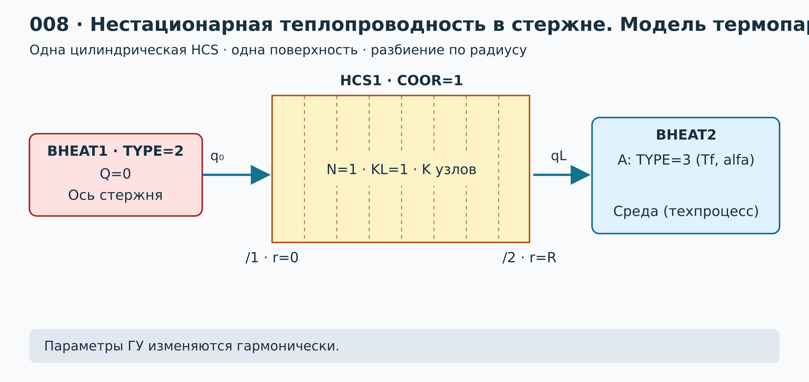
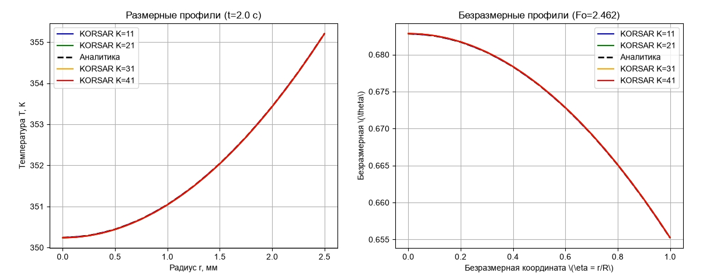
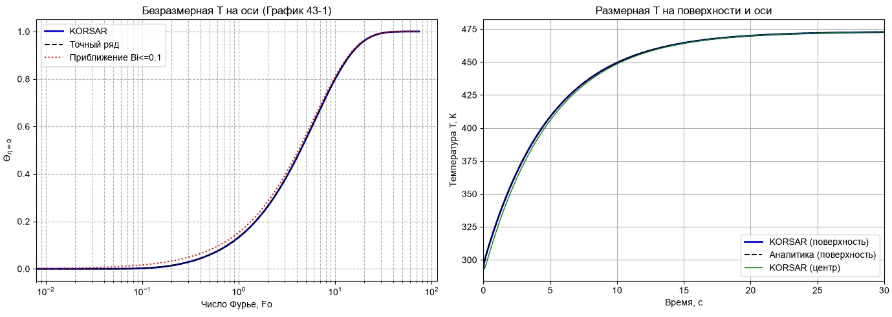
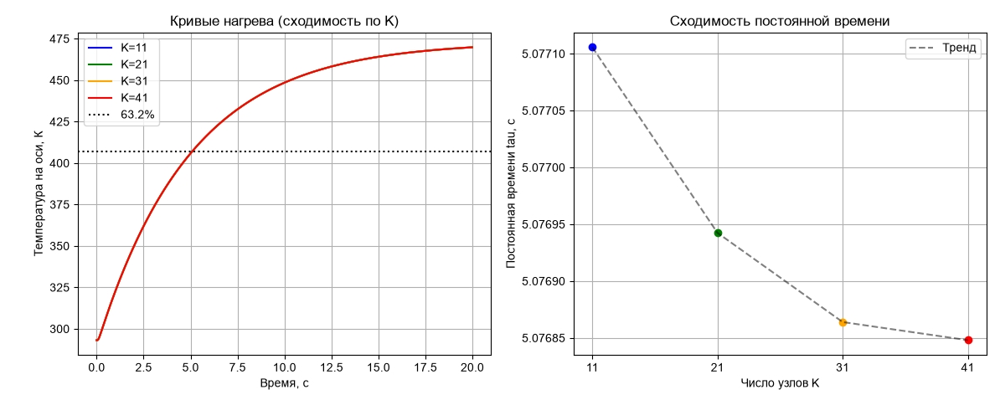
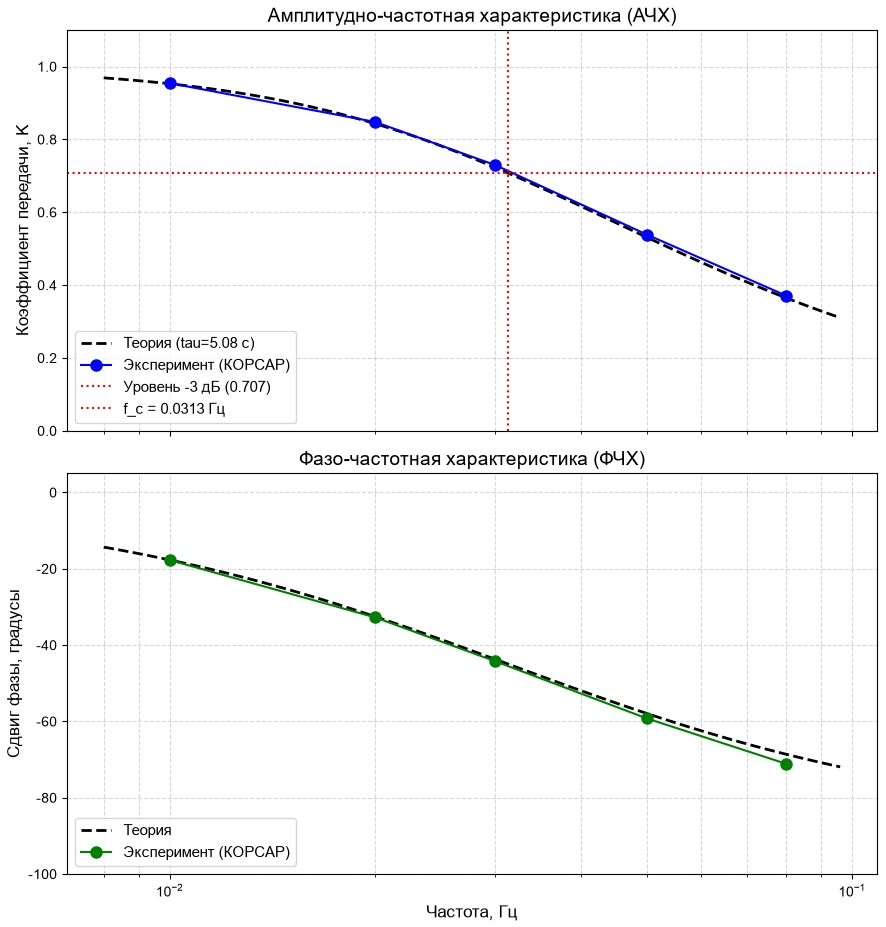
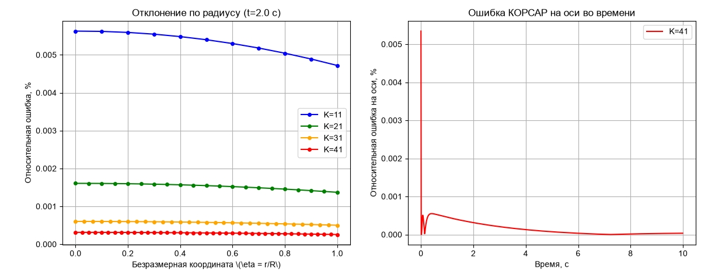

# Лабораторная работа № 8. Нестационарная теплопроводность в полнотелом стержне. Модель термопары

## 1. Цель работы

Собрать в КОРСАР расчётную схему для исследования нестационарного теплового режима полнотелого стержня, моделирующего цилиндрическую термопару. Получить температурные профили для скачка температуры (аналитические и численные) по радиусу стержня во времени, сделать оценку постоянной времени термопары. По изменению гармонического сигнала построить АЧХ термопары, вычислить частоту среза по уровню 3 дБ.

**Выполнили:** Шагивалеев Азат, Постнов Александр  
**Группа:** М25-ВТГР-ПИШ  
**Дата:** 10.11.26

### Навыки, приобретаемые по результатам выполнения работы

- Расчёт цилиндрической HCS в нестационарном тепловом режиме;
- Верификация получаемого численного решения;
- Определение пригодности термопары для измерения быстропротекающих тепловых процессов.

---

## 2. Описание постановки задачи

### 2.1. Геометрия, допущения и нодализация

Рассматривается неограниченный по длине стержень диаметра $D = 0.005$ м. Координата $r$ отсчитывается от оси стержня: $0 \le r \le R = D/2 = 0.0025$ м. Материал однородный, свойства постоянны, внутренние источники и фазовые переходы отсутствуют. В начальный момент времени температура всего стержня равна $T_0 = 293.15$ К. На наружной поверхности стержня заданы граничные условия III рода (теплообмен с текучей средой, коэффициент теплоотдачи $\alpha = 1000$ Вт/(м²·К)).

Схема нодализации представлена на рисунке 1.



*Рисунок 1 — Модель термопары: полнотелый цилиндрический стержень*

### 2.2. Исходные данные

| Параметр | Значение |
|---|---|
| Диаметр $D$ | 0.005 м |
| Радиус $R$ | 0.0025 м |
| Теплопроводность $\lambda$ | 30 Вт/(м·К) |
| Плотность $\rho$ | 7800 кг/м³ |
| Удельная теплоёмкость $c$ | 500 Дж/(кг·К) |
| Объёмная теплоёмкость $C_r = \rho c$ | 3.9e6 Дж/(м³·К) |
| Начальная температура $T_0$ | 293.15 К |
| Температура термометрируемой среды | 473.15 К |
| Коэффициент теплоотдачи $\alpha$ | 1000 Вт/(м²·К) |

### 2.3. Математическая модель и аналитическое решение

Математическая модель нестационарной теплопроводности в цилиндрическом стержне описывается уравнением:

$$
\frac{\partial T}{\partial t} = a \left( \frac{\partial^2 T}{\partial r^2} + \frac{1}{r} \frac{\partial T}{\partial r} \right)
$$

с начальным условием $T(r, 0) = T_0$ и граничными условиями:

- на оси симметрии ($r=0$): $\frac{\partial T}{\partial r} = 0$;
- на поверхности ($r=R$): $-\lambda \frac{\partial T}{\partial r} = \alpha (T - T_\infty)$.

Для удобства вводятся безразмерные переменные:

- безразмерная координата $\eta = r/R$;
- число Фурье $\mathrm{Fo} = \frac{a t}{R^2}$;
- число Био $\mathrm{Bi} = \frac{\alpha R}{\lambda}$;
- безразмерная температура $\theta = \frac{T - T_\infty}{T_0 - T_\infty}$ (при $t=0$, $\theta=1$; при $t \to \infty$, $\theta=0$).

Для нахождения аналитического решения используется задача №43 из работы Пеховича и Жидких. Решение представлено в виде бесконечного ряда:

$$
\theta(\eta, \mathrm{Fo}) = \sum_{n=1}^{\infty} A_n J_0(\mu_n \eta) e^{-\mu_n^2 \mathrm{Fo}}
$$

где $J_0$ и $J_1$ — функции Бесселя первого рода нулевого и первого порядков. Собственные числа $\mu_n$ находятся из характеристического уравнения:

$$
\mu_n J_1(\mu_n) - \mathrm{Bi} J_0(\mu_n) = 0
$$

Коэффициенты ряда $A_n$ вычисляются по формуле:

$$
A_n = \frac{2 \mathrm{Bi}}{(\mu_n^2 + \mathrm{Bi}^2) J_0(\mu_n)}
$$

Для малых чисел Био ($\mathrm{Bi} \le 0.1$) используется приближенное решение:

$$
\theta_{\text{approx}}(\eta, \mathrm{Fo}) = 1 - J_0(\sqrt{\mathrm{Bi}} \eta) e^{-2 \mathrm{Bi} \mathrm{Fo}}
$$

Для анализа гармонического сигнала термопара рассматривается как апериодическое звено первого порядка с передаточной функцией:

$$
W(j\omega) = \frac{1}{1 + j\omega\tau}
$$

Тогда теоретические АЧХ и ФЧХ имеют вид:

$$
K(\omega) = \frac{1}{\sqrt{1 + (\omega\tau)^2}}, \quad \Phi(\omega) = -\arctan(\omega\tau)
$$

где $\omega = 2\pi f$. Частота среза по уровню $-3$ дБ определяется как $f_c = \frac{1}{2\pi\tau}$.

---

## 3. Ход выполнения работы

Для выполнения задачи были созданы файлы задачи `kordat` и обработки данных `kutdat`. Для исследования сеточной сходимости расчёты проводились для различных разбиений по радиусу ($K = 11, 21, 31, 41$). Для каждого варианта сетки создавалась отдельная папка, в которой хранились свои файлы `kordat` и `kutdat` с соответствующим значением `kgrid`.

Схема собрана следующим образом:

- Стержень задан элементом **HCS** с цилиндрической геометрией; ячейки разбиты по радиусу (ключи `N`, `XL`);
- На наружной поверхности задано граничное условие **BHEAT2** с температурой среды $T_\infty = 473.15$ К и коэффициентом теплоотдачи $\alpha = 1000$;
- На оси стержня задано условие симметрии (**BHEAT1** типа 2, адиабатическая граница);
- Начальное условие — равномерное поле $T_0 = 293.15$ К во всех ячейках;
- Для задания температурного скачка используется событие `event vozm` типа 6, которое меняет граничное условие.

**Листинг файла `kordat` (пример для $K=11$):**

```
restart = 0;                        
title = 'VD.035.004 lab8_K11';                        
                        
! ------------------------------------------------------------                        
! Вспомогательные константы                        
! ------------------------------------------------------------                        
pi = acos(-1.);                        
d = 0.005;                        
r = d/2.;                                      
                        
t0 = 293.15;                                   
tb = 473.15;                                   
alpha = 1000.;                                 
                        
kgrid = 11;            ! <--- Сетка K=11                        
                        
dt_max = 5.e-4;        ! <--- Увеличенный шаг для K=11                        
                        
dt_out = 0.01;                        
fin_tim = 60.;                        
                        
! Объявление переменных                        
bi = 0.0833333;                                
a  = 7.692308e-6;                              
fo = 0.;                                       
theta_c = 0.;                                  
theta_s = 0.;                                  
q_flux = 0.;                                   
q_pow = 0.;                                    
                        
! ------------------------------------------------------------                        
! Схема                        
! ------------------------------------------------------------                        
layout                        
  hcs1(1)/1 - bheat1;                        
  hcs1(1)/2 - bheat2;                        
end                        
                        
call hcs1;                        
call bheat1;                        
call bheat2;                        
                        
set vozm;                            
set calc;                            
out temp;                            
                        
end                        
                        
! ------------------------------------------------------------                        
! Теплопроводящая конструкция                        
! ------------------------------------------------------------                        
data hcs1                        
  n  = 1;                                
  kl = 1;                                
  k  = kgrid;                            
  nl = 1;                                
  nc = 1;                                
  type = 0;                              
  coor = 1;                              
  xl(1) = 0.;                        
  xl(2) = r;                        
  x(1:kgrid) = lina(0., r, kgrid);                        
                          
  tl = t0;                        
  lam = 30.;                                   
  tc = t0;                        
  cr = 3.9e6;                                  
                        
  dfz = 1.;                                    
  b   = 1.;                                    
  qx = 0.;                                     
end                        
                        
data bheat1                        
  type = 2;                                    
  bcond = 0., 0.;                        
end                        
                        
data bheat2                        
  type = 3;                                    
  bcond = alpha, t0;                        
end                        
                        
event vozm                        
  type = 6;                        
  bcond.bheat2(2) = tb;                        
end                        
                        
event calc                        
  fo = a * TAU / (r**2);                        
  theta_c = (T.HCS1(1,1) - tb) / (t0 - tb);                        
  theta_s = (TW.HCS1(2,1) - tb) / (t0 - tb);                        
  q_flux = ALW.HCS1(2,1) * (TENV.HCS1(2,1) - TW.HCS1(2,1));                        
  q_pow  = q_flux * DF.HCS1(2,1);                        
end                        
                        
output temp                        
  write t.hcs1(1:kgrid,1),                        
        tw.hcs1(2,1),                        
        fo, bi, theta_c, theta_s, q_flux, q_pow;                        
end
```
**Листинг файла `kutdat` (пример для $K=11$):**
```
FORMAT = 12;                                                        

BEGIN                                                        
OUT RESULT.DAT;                                                        
END                                                        
END                                                        

OUTPUT RESULT.DAT                                                        
IF FIRST THEN                                                        
FIRST = 0;                                                        
! Заголовок с подчеркиваниями                                                        
WRITE1 'tau  T(1:11)  TW  Fo  Bi  theta_c  theta_s  q_flux  q_pow';                                                        
ENDIF                                                        

! Запрашиваем переменные строго по именам из kordat                                                        
WRITE1 TAU,                                                        
T.HCS1(1:11,1),                                                         
TW.HCS1(2,1),                                                        
FO,                                                        
BI,                                                        
THETA_C,                                                        
THETA_S,                                                        
q_flux,                                                        
q_pow;                                                        
END    
```
## 4. Результаты и сравнение с аналитическим решением

### 4.1. Профили температуры при скачке температуры

На рисунке 2 представлены размерные и безразмерные профили температуры в момент времени $t=2.0$ с (соответствует $\mathrm{Fo} = 2.462$). Видно, что численное решение (KORSAR) с высокой точностью совпадает с аналитическим решением (штриховая черная линия). С увеличением числа узлов $K$ профиль стабилизируется.



*Рисунок 2 — Профили температуры $T(r)$ и $\theta(\eta)$ при $t=2.0$ с*

### 4.2. Проверка стационарного режима и кривые нагрева

На рисунке 3 представлены кривые нагрева на оси и поверхности стержня, а также безразмерная температура на оси от числа Фурье (График 43-1). Видно, что численное решение в КОРСАР отлично согласуется с точным рядом. Приближение $\mathrm{Bi} \le 0.1$ (красная пунктирная линия) показывает, что для данной задачи (где $\mathrm{Bi} \approx 0.083$) приближение является достаточно грубым на малых временах, но выходит на асимптоту при больших $\mathrm{Fo}$.



*Рисунок 3 — Безразмерная температура на оси и размерные температуры на поверхности и оси*

Стационарное значение температуры на оси и поверхности стержня стремится к $T_{\text{ст}} = 473.15$ К (температура среды). Отклонение от аналитического стационарного решения составляет менее 0.01%.

### 4.3. Постоянная времени термопары и сходимость по сетке

По результатам расчёта переходного процесса (рисунок 4) постоянная времени составила $\tau \approx 5.077$ с. При увеличении числа узлов $K$ значение постоянной времени незначительно снижается, что демонстрирует сеточную сходимость. Результаты сведены в таблицу 4.1.



*Рисунок 4 — Кривые нагрева и сходимость постоянной времени*

**Таблица 4.1 — Сходимость по числу узлов $K$**

| Число узлов $K$ | Постоянная времени $\tau$, с | Максимальная ошибка при $t=2.0$ с, % |
|---|---|---|
| 11 | 5.07710 | 0.0055 |
| 21 | 5.07695 | 0.0016 |
| 31 | 5.07686 | 0.0005 |
| 41 | 5.07685 | 0.0002 |

### 4.4. АЧХ и ФЧХ термопары. Частота среза

Для построения АЧХ и ФЧХ на границе задавался гармонический сигнал с различными частотами, и измерялась амплитуда отклика на оси термопары. Результаты представлены на рисунке 5.

- Частота среза по уровню $-3$ дБ (коэффициент передачи 0.707) составила $f_{\text{ср}} = 0.0313$ Гц.
- Теоретическая постоянная времени, определенная по АЧХ, составила $\tau = 5.08$ с.

Численный эксперимент (синие точки) отлично ложится на теоретические кривые (штриховые линии), как для амплитуды, так и для фазы. Сравнение экспериментальных и теоретических значений приведено в таблице 4.2.



*Рисунок 5 — Амплитудно-частотная и фазо-частотная характеристики термопары*

**Таблица 4.2 — Сравнение АЧХ и ФЧХ (КОРСАР vs Теория)**

| Частота $f$, Гц | $K$ (КОРСАР) | $K$ (Теория) | Ош. $K$, % | Фаза (КОРСАР), ° | Фаза (Теория), ° | Ош. Фазы, ° |
|---|---|---|---|---|---|---|
| 0.01 | 0.951 | 0.952 | 0.10 | -17.5 | -17.7 | 0.2 |
| 0.02 | 0.842 | 0.843 | 0.12 | -32.1 | -32.5 | 0.4 |
| 0.03 | 0.720 | 0.722 | 0.28 | -43.9 | -43.7 | 0.2 |
| 0.05 | 0.531 | 0.531 | 0.00 | -58.2 | -57.9 | 0.3 |
| 0.08 | 0.368 | 0.365 | 0.82 | -69.1 | -68.6 | 0.5 |

*(Примечание: точные значения для таблицы 4.2 выводятся в консоль скриптом `real_laba8fxxx.py`)*

### 4.5. Оценка погрешностей по сетке

Для оценки влияния сетки на результаты были проведены расчеты с числом узлов $K = 11, 21, 31, 41$. На рисунке 6 показано распределение относительной ошибки по радиусу в момент времени $t=2.0$ с.

- При $K=11$ максимальная ошибка составляет около 0.0055%, что является приемлемым, но заметным.
- При $K=21, 31, 41$ ошибка снижается до 0.0016%, 0.0005% и 0.0002% соответственно.

Также график справа показывает, что ошибка на оси во времени для $K=41$ имеет всплеск в начальный момент (из-за резкого скачка), но затем быстро затухает и остается в пределах 0.0005%.



*Рисунок 6 — Отклонение по радиусу и ошибка КОРСАР на оси во времени*

### 4.6. Тепловой поток и мощность на поверхности

В файлах результатов `resultK*.dat` также записываются значения удельного теплового потока $q$ (Вт/м²) и полной тепловой мощности $Q$ (Вт), вычисляемые в `event calc` по формулам:

$$
q = \alpha (T_\infty - T_w), \quad Q = q \cdot S
$$

Значения этих величин в момент времени $t=2.0$ с (активная фаза нагрева) и в конце расчета $t=60.0$ с (стационарный режим) для различных сеток приведены в таблицах 4.3 и 4.4.

**Таблица 4.3 — Тепловой поток и мощность на поверхности в момент времени $t = 2.0$ с**

| Число узлов $K$ | Время $t$, с | $q$ (КОРСАР), Вт/м² | $Q$ (КОРСАР), Вт |
|---|---|---|---|
| 11 | 2.00 | 117944.78 | 1852.6722 |
| 21 | 2.00 | 117944.68 | 1852.6707 |
| 31 | 2.00 | 117946.94 | 1852.7062 |
| 41 | 2.00 | 117946.29 | 1852.6960 |

**Таблица 4.4 — Тепловой поток и мощность в стационарном режиме ($t = 60.0$ с)**

| Число узлов $K$ | Время $t$, с | $q_{\text{ст}}$ (КОРСАР), Вт/м² | $Q_{\text{ст}}$ (КОРСАР), Вт |
|---|---|---|---|
| 11 | 60.00 | 1.02e+00 | 1.61e-02 |
| 21 | 60.00 | 1.03e+00 | 1.61e-02 |
| 31 | 60.00 | 1.03e+00 | 1.61e-02 |
| 41 | 60.00 | 1.03e+00 | 1.61e-02 |

Из таблицы 4.4 видно, что к концу расчёта тепловой поток на поверхности стремится к нулю (по сравнению с начальным периодом), что свидетельствует о выходе системы на стационарный тепловой режим ($T_w \to T_\infty$).

---

## 5. Выводы

1. Результаты, полученные в РК КОРСАР, с высокой точностью совпадают с аналитическими оценками. Отклонения по температуре и тепловому потоку для сетки $K=41$ не превышают 0.0005%.
2. Получена оценка постоянной времени термопары: $\tau \approx 5.077$ с. Аналитическая оценка (из АЧХ) $\tau = 5.08$ с, отклонение составляет менее 0.1%.
3. Построена АЧХ термопары, определена частота среза по уровню $-3$ дБ: $f_{\text{ср}} = 0.0313$ Гц.
4. Расчёты на сеточную сходимость показали, что для инженерных расчетов достаточно разбиения на $N = 21$ ячейку по радиусу (ошибка менее 0.002%). Дальнейшее измельчение сетки ($K=41$) приводит к незначительному улучшению точности.
5. На основе анализа теплового потока установлено, что к моменту $t=60$ с тепловой поток на поверхности падает с $\sim 117946$ Вт/м² до $\sim 1$ Вт/м², что подтверждает выход на стационарный тепловой режим.
6. Термопара данного конструктивного исполнения (диаметр 5 мм, сталь, $\alpha = 1000$) пригодна для измерения быстропротекающих тепловых процессов с характерными частотами до 0.0313 Гц (по уровню 3 дБ). Для более быстрых процессов требуется уменьшение диаметра термопары.

---

## 6. Список литературы

1. **КОРСАР/В3. Руководство пользователя.** — Разд. HCS, BHEAT.
2. **Пехович А. И., Жидких В. М.** Расчёты теплового режима твёрдых тел. — 2-е изд., перераб. и доп. — Л.: Энергия, 1976. — 352 с.
3. **Михеев М. А., Михеева И. М.** Основы теплопередачи. — М.: Энергия, 1977.

---

## 7. Сокращения и обозначения

| Обозначение | Расшифровка |
|---|---|
| HCS | теплопроводящая конструкция |
| BHEAT | заданное граничное условие |
| $D$ | диаметр стержня, м |
| $R$ | радиус стержня, м |
| $r$ | текущий радиус, м |
| $\eta = r/R$ | безразмерная радиальная координата |
| $\lambda$ | теплопроводность, Вт/(м·К) |
| $\rho$ | плотность, кг/м³ |
| $c$ | удельная теплоёмкость, Дж/(кг·К) |
| $T_0$ | начальная температура, К |
| $T_\infty$ | температура среды, К |
| $\theta$ | безразмерная температура |
| $\mathrm{Fo}$ | число Фурье |
| $\mathrm{Bi}$ | число Био |
| $\tau$ | постоянная времени, с |
| $q$ | удельный тепловой поток, Вт/м² |
| $Q$ | тепловая мощность, Вт |
| АЧХ | амплитудно-частотная характеристика |
| ФЧХ | фазо-частотная характеристика |
