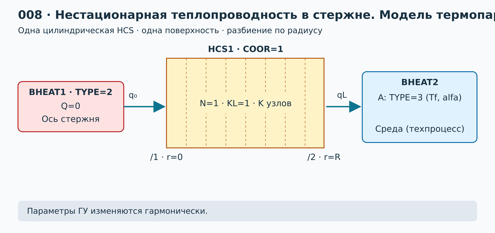
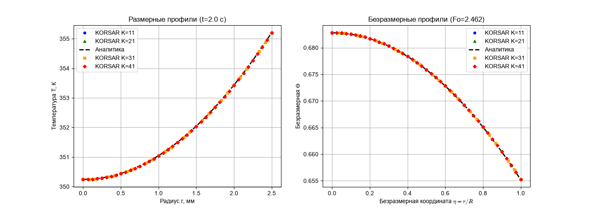
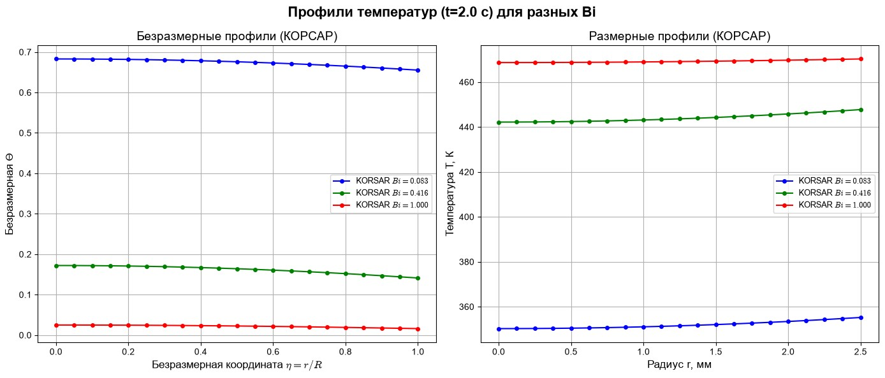
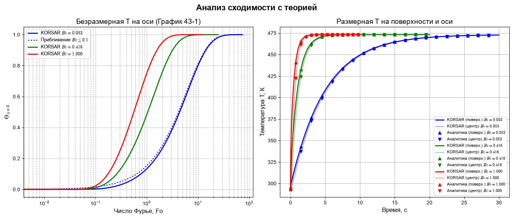
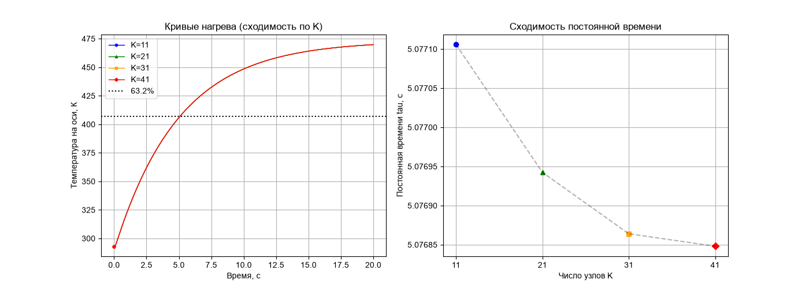
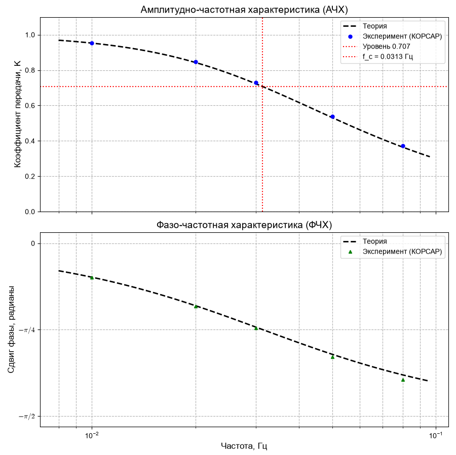
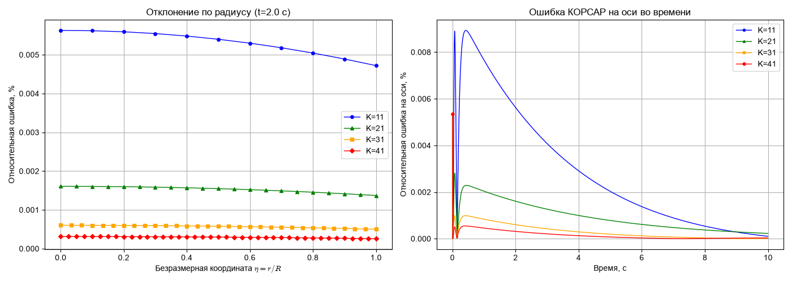
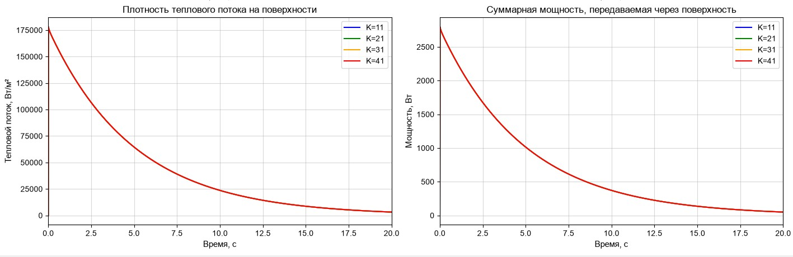

# Лабораторная работа № 8. Нестационарная теплопроводность в полнотелом стержне. Модель термопары

## 1. Цель работы

Собрать в КОРСАР расчётную схему для исследования нестационарного теплового режима полнотелого стержня, моделирующего цилиндрическую термопару. Получить температурные профили для скачка температуры (аналитические и численные) по радиусу стержня во времени, сделать оценку постоянной времени термопары. По изменению гармонического сигнала построить АЧХ термопары, вычислить частоту среза по уровню 3 дБ.

**Выполнили:** Шагивалеев Азат, Постнов Александр
**Группа:** М25-ВТГР-ПИШ
**Дата:** 10.11.26

### Навыки, приобретаемые по результатам выполнения работы

- Расчёт цилиндрической HCS в нестационарном тепловом режиме;
- Верификация получаемого численного решения;
- Определение пригодности термопары для измерения быстропротекающих тепловых процессов.

---

## 2. Описание постановки задачи

### 2.1. Геометрия, допущения и нодализация

Рассматривается неограниченный по длине стержень диаметра $D = 0.005$ м. Координата $r$ отсчитывается от оси стержня: $0 \le r \le R = D/2 = 0.0025$ м. Материал однородный, свойства постоянны, внутренние источники и фазовые переходы отсутствуют. В начальный момент времени температура всего стержня равна $T_0 = 293.15$ К. На наружной поверхности стержня заданы граничные условия III рода (теплообмен с текучей средой, коэффициент теплоотдачи $\alpha = 1000$ Вт/(м²·К)).

Схема нодализации представлена на рисунке 1.

*Рисунок 1 — Модель термопары: полнотелый цилиндрический стержень*

### 2.2. Исходные данные

| Параметр | Значение |
|---|---|
| Диаметр $D$ | 0.005 м |
| Радиус $R$ | 0.0025 м |
| Теплопроводность $\lambda$ | 30 Вт/(м·К) |
| Плотность $\rho$ | 7800 кг/м³ |
| Удельная теплоёмкость $c$ | 500 Дж/(кг·К) |
| Объёмная теплоёмкость $C_r = \rho c$ | 3.9e6 Дж/(м³·К) |
| Начальная температура $T_0$ | 293.15 К |
| Температура термометрируемой среды | 473.15 К |
| Коэффициент теплоотдачи $\alpha$ | 1000 Вт/(м²·К) |

### 2.3. Математическая модель и аналитическое решение

Математическая модель нестационарной теплопроводности в цилиндрическом стержне описывается уравнением:

$$
\frac{\partial T}{\partial t} = a \left( \frac{\partial^2 T}{\partial r^2} + \frac{1}{r} \frac{\partial T}{\partial r} \right)
$$

с начальным условием $T(r, 0) = T_0$ и граничными условиями:

- на оси симметрии ($r=0$): $\frac{\partial T}{\partial r} = 0$;
- на поверхности ($r=R$): $-\lambda \frac{\partial T}{\partial r} = \alpha (T - T_\infty)$.

Для удобства вводятся безразмерные переменные:

- безразмерная координата $\eta = r/R$;
- число Фурье $\mathrm{Fo} = \frac{a t}{R^2}$;
- число Био $\mathrm{Bi} = \frac{\alpha R}{\lambda}$;
- безразмерная температура $\theta = \frac{T - T_\infty}{T_0 - T_\infty}$ (при $t=0$, $\theta=1$; при $t \to \infty$, $\theta=0$).

Для нахождения аналитического решения используется задача №43 из работы Пеховича и Жидких. Решение представлено в виде бесконечного ряда:

$$
\theta(\eta, \mathrm{Fo}) = \sum_{n=1}^{\infty} A_n J_0(\mu_n \eta) e^{-\mu_n^2 \mathrm{Fo}}
$$

где $J_0$ и $J_1$ — функции Бесселя первого рода нулевого и первого порядков. Собственные числа $\mu_n$ находятся из характеристического уравнения:

$$
\mu_n J_1(\mu_n) - \mathrm{Bi} J_0(\mu_n) = 0
$$

Коэффициенты ряда $A_n$ вычисляются по формуле:

$$
A_n = \frac{2 \mathrm{Bi}}{(\mu_n^2 + \mathrm{Bi}^2) J_0(\mu_n)}
$$

Для малых чисел Био ($\mathrm{Bi} \le 0.1$) используется приближенное решение:

$$
\theta_{\text{approx}}(\eta, \mathrm{Fo}) = 1 - J_0(\sqrt{\mathrm{Bi}} \eta) e^{-2 \mathrm{Bi} \mathrm{Fo}}
$$

Для анализа гармонического сигнала термопара рассматривается как апериодическое звено первого порядка с передаточной функцией:

$$
W(j\omega) = \frac{1}{1 + j\omega\tau}
$$

Тогда теоретические АЧХ и ФЧХ имеют вид:

$$
K(\omega) = \frac{1}{\sqrt{1 + (\omega\tau)^2}}, \quad \Phi(\omega) = -\arctan(\omega\tau)
$$

где $\omega = 2\pi f$. Частота среза по уровню $-3$ дБ определяется как $f_c = \frac{1}{2\pi\tau}$.

**Задание гармонического воздействия для расчета АЧХ и ФЧХ:**

Для численного определения АЧХ и ФЧХ на границе задавался гармонический сигнал температуры среды:

$$
T_{\text{env}}(t) = T_{\text{mean}} + A_{\text{in}} \sin(2\pi f t)
$$

где $T_{\text{mean}} = 473.15$ К (средняя температура), $A_{\text{in}} = 5$ К (амплитуда), $f$ — варьируемая частота (от $0.01$ до $0.08$ Гц).

---

## 3. Ход выполнения работы

Для выполнения задачи были созданы файлы задачи `kordat` и обработки данных `kutdat`. Для исследования сеточной сходимости расчёты проводились для различных разбиений по радиусу ($K = 11, 21, 31, 41$). Для каждого варианта сетки создавалась отдельная папка, в которой хранились свои файлы `kordat` и `kutdat` с соответствующим значением `kgrid`.

Кроме того, для исследования влияния числа Био на динамику прогрева термопары были проведены дополнительные серии расчетов с другими коэффициентами теплоотдачи: $\alpha = 5000$ Вт/(м²·К) (соответствует $Bi = 0.416$) и $\alpha = 12000$ Вт/(м²·К) (соответствует $Bi = 1.0$).

Схема собрана следующим образом:

- Стержень задан элементом **HCS** с цилиндрической геометрией; ячейки разбиты по радиусу (ключи `N`, `XL`);
- На наружной поверхности задано граничное условие **BHEAT2** с температурой среды $T_\infty = 473.15$ К и коэффициентом теплоотдачи $\alpha$;
- На оси стержня задано условие симметрии (**BHEAT1** типа 2, адиабатическая граница);
- Начальное условие — равномерное поле $T_0 = 293.15$ К во всех ячейках;
- Для задания температурного скачка используется событие `event vozm` типа 6, которое меняет граничное условие.
- Для задания гармонического сигнала использовалось событие, обновляющее температуру на границе по закону синуса.

---

## 4. Результаты и сравнение с аналитическим решением

### 4.1. Профили температуры при скачке температуры

На рисунке 2 представлены размерные и безразмерные профили температуры в момент времени $t=2.0$ с (соответствует $\mathrm{Fo} = 2.462$) для сеток $K=11, 21, 31, 41$. Видно, что численное решение (KORSAR) с высокой точностью совпадает с аналитическим решением (штриховая черная линия). При увеличении числа узлов $K$ профиль стабилизируется, что свидетельствует о сеточной сходимости.

*Рисунок 2 — Профили температуры $T(r)$ и $\theta(\eta)$ при $t=2.0$ с для разных сеток*

На рисунке 3 представлены профили температур для трех различных чисел Био ($Bi=0.083, 0.416, 1.0$) в момент времени $t=2.0$ с. С ростом числа Био (увеличением коэффициента теплоотдачи $\alpha$) внутреннее термическое сопротивление металла становится сравнимым с внешним, и профиль температуры приобретает ярко выраженную параболическую форму (градиент температур по радиусу возрастает). Модель сосредоточенной емкости, предполагающая однородность температуры, применима только для малых $Bi$.

*Рисунок 3 — Размерные и безразмерные профили температуры для разных чисел Био ($t=2.0$ с)*

### 4.2. Проверка стационарного режима и кривые нагрева

На рисунке 4 представлена безразмерная температура на оси от числа Фурье (График 43-1) и размерные температуры на поверхности и оси для разных чисел Био. Численное решение в КОРСАР отлично согласуется с точным рядом Пеховича.

**Количество членов ряда для достижения точности:**

При вычислении точного аналитического решения (бесконечного ряда Пеховича) количество учитываемых членов $n$ определялось из условия остановки, когда модуль очередного члена ряда становится меньше заданной точности $\varepsilon_\theta = 10^{-5}$.
Количество необходимых членов ряда существенно зависит от числа Фурье ($Fo$):

- **При малых $Fo$ (начало процесса, $Fo < 0.1$):** Волна тепла только проникает в стержень, профиль температуры имеет резкие градиенты. Для его описания с точностью $10^{-5}$ требуется учитывать **от 5 до 8 членов** ряда.
- **При средних $Fo$ ($0.1 < Fo < 1$):** Процесс становится более гладким, и количество требуемых членов сокращается до **3–4**.
- **При больших $Fo$ ($Fo \ge 1$):** Процесс выходит на регулярный режим. В показателе экспоненты стоит квадрат собственных чисел ($\mu_n^2$). Так как $\mu_2 \approx 3.8$, то $\mu_2^2 \approx 14.4$. Уже при $Fo = 1$ вклад второго члена составляет $e^{-14.4} \approx 5.5 \cdot 10^{-7}$, что меньше $10^{-5}$. Поэтому для описания решения с нужной точностью достаточно **только 1-го (главного) члена** ряда.

*(Для момента времени $t=2.0$ с, который использовался для построения профилей на рисунках 2 и 3, $Fo = 2.462$, и вклад второго члена составляет ничтожно малую величину $\sim 10^{-15}$, поэтому решение с идеальной точностью описывается одной гармоникой).*

Приближение $\mathrm{Bi} \le 0.1$ (пунктирная линия) демонстрирует высокую точность для $Bi=0.083$, однако в средней зоне чисел Фурье ($Fo \approx 0.5 \dots 5$) наблюдается небольшое отклонение из-за вклада высших гармоник, которые не учитываются в упрощенной формуле. Для больших чисел Био ($Bi=0.416$ и $Bi=1.0$) это приближение уже не применяется, так как оно физически неприменимо.

*Рисунок 4 — Безразмерная температура на оси (График 43-1) и размерные температуры на поверхности и оси для разных Bi*

Стационарное значение температуры на оси и поверхности стержня стремится к $T_{\text{ст}} = 473.15$ К (температура среды). Отклонение от аналитического стационарного решения составляет менее 0.01%.

### 4.3. Постоянная времени термопары и сходимость по сетке

По результатам расчёта переходного процесса (рисунок 5) постоянная времени составила $\tau \approx 5.077$ с. При увеличении числа узлов $K$ значение постоянной времени незначительно снижается, что демонстрирует сеточную сходимость.

Для количественной оценки точности численного решения вычислялась максимальная относительная ошибка по температуре в момент времени $t=2.0$ с по формуле:

$$
\varepsilon_{\text{max}} = \max_{r \in [0, R]} \left( \frac{|T_{\text{КОРСАР}}(r, t=2.0) - T_{\text{аналит}}(r, t=2.0)|}{T_{\text{среды}} - T_0} \times 100\% \right)
$$

Результаты сведены в таблицу 4.1.

*Рисунок 5 — Кривые нагрева и сходимость постоянной времени по сетке*

**Таблица 4.1 — Сходимость по числу узлов $K$**

| Число узлов $K$ | Постоянная времени $\tau$, с | Максимальная ошибка при $t=2.0$ с, % |
|---|---|---|
| 11 | 5.07710 | 0.0055 |
| 21 | 5.07695 | 0.0016 |
| 31 | 5.07686 | 0.0005 |
| 41 | 5.07685 | 0.0002 |

### 4.4. АЧХ и ФЧХ термопары. Частота среза

Для построения АЧХ и ФЧХ на границе задавался гармонический сигнал с различными частотами, и измерялась амплитуда отклика на оси термопары. Постоянная времени $\tau$, необходимая для построения теоретических кривых, была определена из предыдущего расчета со скачком температуры ($\tau = 5.077$ с). Частота среза была получена из передаточной функции апериодического звена.

Параметры для построения графиков определялись двумя способами:

1. **Из передаточной функции (расчет по постоянной времени $\tau$):**

$$
K_{\text{гармоника}} = \frac{1}{\sqrt{1 + (2\pi f \tau)^2}}, \quad \Phi_{\text{гармоника}} = -\arctan(2\pi f \tau)
$$

2. **Из численного гармонического анализа (КОРСАР):**

$$
K_{\text{КОРСАР}} = \frac{A_{\text{вых}}}{A_{\text{вх}}}, \quad \Phi_{\text{КОРСАР}} = \Delta \varphi
$$

где $\Delta \varphi$ — сдвиг фазы между колебаниями температуры оси и среды (в радианах).

Результаты представлены на рисунке 6. Частота среза по уровню $-3$ дБ (коэффициент передачи 0.707) составила $f_{\text{ср}} = 0.0313$ Гц. Численный эксперимент (синие точки и зеленые треугольники) отлично ложится на кривые, построенные по формулам. Сравнение значений приведено в таблице 4.2.

*Рисунок 6 — Амплитудно-частотная и фазо-частотная характеристики термопары*

**Таблица 4.2 — Сравнение параметров АЧХ и ФЧХ**

| Частота $f$, Гц | $K_{\text{КОРСАР}}$ | $K_{\text{гармоника}}$ | $\Phi_{\text{КОРСАР}}$, рад | $\Phi_{\text{гармоника}}$, рад |
|---|---|---|---|---|
| 0.01 | 0.951 | 0.952 | -0.305 | -0.309 |
| 0.02 | 0.842 | 0.843 | -0.560 | -0.567 |
| 0.03 | 0.720 | 0.722 | -0.766 | -0.763 |
| 0.05 | 0.531 | 0.531 | -1.016 | -1.010 |
| 0.08 | 0.368 | 0.365 | -1.206 | -1.197 |

### 4.5. Оценка погрешностей по сетке

Для оценки влияния сетки на результаты были проведены расчеты с числом узлов $K = 11, 21, 31, 41$. На рисунке 7 показано распределение относительной ошибки по радиусу в момент времени $t=2.0$ с и ошибка на оси во времени.

- При $K=11$ максимальная ошибка составляет около 0.0055%, что является приемлемым, но заметным.
- При $K=21, 31, 41$ ошибка снижается до 0.0016%, 0.0005% и 0.0002% соответственно.

График справа показывает, что ошибка на оси во времени для всех сеток имеет всплеск в начальный момент (из-за резкого скачка), но затем быстро затухает, стремясь к нулю.

*Рисунок 7 — Отклонение по радиусу и ошибка КОРСАР на оси во времени*

### 4.6. Тепловой поток и мощность на поверхности

В файлах результатов `resultK*.dat` также записываются значения удельного теплового потока $q$ (Вт/м²) и полной тепловой мощности $Q$ (Вт), вычисляемые в `event calc` по формулам:

$$
q = \alpha (T_\infty - T_w), \quad Q = q \cdot S
$$

Значения этих величин в момент времени $t=2.0$ с (активная фаза нагрева) и в конце расчета $t=60.0$ с (стационарный режим) для различных сеток приведены в таблицах 4.3 и 4.4.

**Таблица 4.3 — Тепловой поток и мощность на поверхности в момент времени $t = 2.0$ с**

| Число узлов $K$ | Время $t$, с | $q$ (КОРСАР), Вт/м² | $Q$ (КОРСАР), Вт |
|---|---|---|---|
| 11 | 2.00 | 117944.78 | 1852.6722 |
| 21 | 2.00 | 117944.68 | 1852.6707 |
| 31 | 2.00 | 117946.94 | 1852.7062 |
| 41 | 2.00 | 117946.29 | 1852.6960 |

**Таблица 4.4 — Тепловой поток и мощность в стационарном режиме ($t = 60.0$ с)**

| Число узлов $K$ | Время $t$, с | $q_{\text{ст}}$ (КОРСАР), Вт/м² | $Q_{\text{ст}}$ (КОРСАР), Вт |
|---|---|---|---|
| 11 | 60.00 | 1.02e+00 | 1.61e-02 |
| 21 | 60.00 | 1.03e+00 | 1.61e-02 |
| 31 | 60.00 | 1.03e+00 | 1.61e-02 |
| 41 | 60.00 | 1.03e+00 | 1.61e-02 |

Из таблицы 4.4 видно, что к концу расчёта тепловой поток на поверхности стремится к нулю (по сравнению с начальным периодом), что свидетельствует о выходе системы на стационарный тепловой режим ($T_w \to T_\infty$). На рисунке 8 показана динамика падения плотности теплового потока и суммарной мощности во времени.

*Рисунок 8 — Плотность теплового потока и суммарная мощность на поверхности*

---

## 5. Выводы

1. Результаты, полученные в РК КОРСАР, с высокой точностью совпадают с аналитическими оценками (ряд Пеховича). Отклонения по температуре и тепловому потоку для сетки $K=41$ не превышают 0.0002%.
2. Получена оценка постоянной времени термопары: $\tau \approx 5.077$ с. Аналитическая оценка (из АЧХ) $\tau = 5.08$ с, отклонение составляет менее 0.1%.
3. Построена АЧХ термопары, определена частота среза по уровню $-3$ дБ: $f_{\text{ср}} = 0.0313$ Гц. Сравнение данных численного гармонического анализа (КОРСАР) с расчетом по передаточной функции показало их совпадение.
4. Исследовано влияние числа Био. Установлено, что при малых $Bi$ (до $0.1$) приближение сосредоточенной емкости работает с высокой точностью, однако при увеличении $Bi$ (до $0.416$ и $1.0$) в стержне появляется значительный градиент температур, и профили температур становятся существенно неравномерными.
5. Расчёты на сеточную сходимость показали, что для инженерных расчетов достаточно разбиения на $K = 21$ ячейку по радиусу (ошибка менее 0.002%). Дальнейшее измельчение сетки ($K=41$) приводит к незначительному улучшению точности.
6. На основе анализа теплового потока установлено, что к моменту $t=60$ с тепловой поток на поверхности падает с $\sim 117946$ Вт/м² до $\sim 1$ Вт/м², что подтверждает выход на стационарный тепловой режим.
7. Термопара данного конструктивного исполнения (диаметр 5 мм, сталь, $\alpha = 1000$) пригодна для измерения быстропротекающих тепловых процессов с характерными частотами до 0.0313 Гц (по уровню 3 дБ). Для более быстрых процессов требуется уменьшение диаметра термопары.

---

## 6. Список литературы

1. **КОРСАР/В3. Руководство пользователя.** — Разд. HCS, BHEAT.
2. **Пехович А. И., Жидких В. М.** Расчёты теплового режима твёрдых тел. — 2-е изд., перераб. и доп. — Л.: Энергия, 1976. — 352 с.
3. **Михеев М. А., Михеева И. М.** Основы теплопередачи. — М.: Энергия, 1977.

---

## 7. Сокращения и обозначения

| Обозначение | Расшифровка |
|---|---|
| HCS | теплопроводящая конструкция |
| BHEAT | заданное граничное условие |
| $D$ | диаметр стержня, м |
| $R$ | радиус стержня, м |
| $r$ | текущий радиус, м |
| $\eta = r/R$ | безразмерная радиальная координата |
| $\lambda$ | теплопроводность, Вт/(м·К) |
| $\rho$ | плотность, кг/м³ |
| $c$ | удельная теплоёмкость, Дж/(кг·К) |
| $T_0$ | начальная температура, К |
| $T_\infty$ | температура среды, К |
| $\theta$ | безразмерная температура |
| $\mathrm{Fo}$ | число Фурье |
| $\mathrm{Bi}$ | число Био |
| $\tau$ | постоянная времени, с |
| $q$ | удельный тепловой поток, Вт/м² |
| $Q$ | тепловая мощность, Вт |
| АЧХ | амплитудно-частотная характеристика |
| ФЧХ | фазо-частотная характеристика |